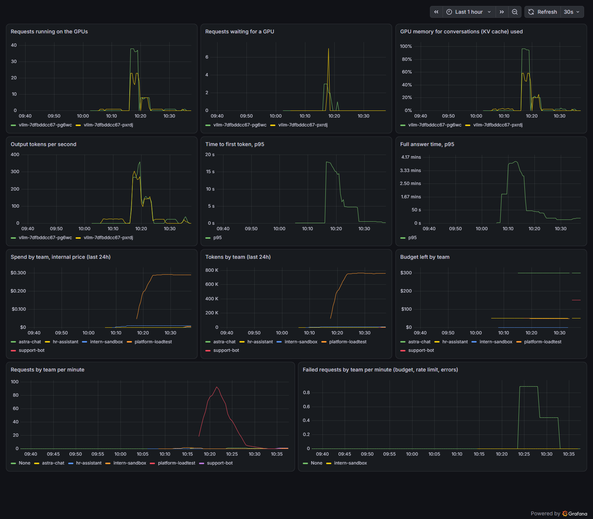

# Astra deployment guide

In this lab you build **Astra**, a company's internal inference API. **Inference** means running a model to get an answer. The company's AI engineers call Astra from their own applications, the same way they would call OpenAI, with an address, a key and a model name.

A company that needs AI answers has two choices. It can call a **frontier model**, one of the most capable models, run by its maker (OpenAI, Anthropic, Google) and paid per token. Or it can run an open model on its own machines and offer it to its engineers as an internal API. Astra is the second choice. Behind the name runs **Qwen3.8-27B**, downloaded once and run in the company's own Amazon Web Services (AWS) account. Many companies do exactly this and give the result their own name.

Every command, output and timing in this guide comes from a real build in AWS on 14 October 2026. Where something was not tested, the guide says so.

## Contents

- [How Astra works, in plain words](#how-astra-works-in-plain-words)
- [The system in one picture](#the-system-in-one-picture)
- [Part 1. The decisions](#part-1-the-decisions)
- [Part 2. Build it](#part-2-build-it)
  - [Step 0. Before you start](#step-0-before-you-start)
  - [Step 1. Build the AWS layer](#step-1-build-the-aws-layer)
  - [Step 2. Connect to the cluster and lay the basics](#step-2-connect-to-the-cluster-and-lay-the-basics)
  - [Step 3. Install monitoring](#step-3-install-monitoring)
  - [Step 4. Add the GPU node pool](#step-4-add-the-gpu-node-pool)
  - [Step 5. Promote the model into the company bucket](#step-5-promote-the-model-into-the-company-bucket)
  - [Step 6. Start the model servers](#step-6-start-the-model-servers)
  - [Step 7. Start the gateway](#step-7-start-the-gateway)
  - [Step 8. Create teams, budgets and keys](#step-8-create-teams-budgets-and-keys)
  - [Step 9. Call the Astra API](#step-9-call-the-astra-api)
  - [Step 10. Prove the controls](#step-10-prove-the-controls)
  - [Step 11. Measure throughput and set the internal price](#step-11-measure-throughput-and-set-the-internal-price)
  - [Step 12. Dashboard, spend report and alerts](#step-12-dashboard-spend-report-and-alerts)
  - [Step 13. What went wrong during the build](#step-13-what-went-wrong-during-the-build)
  - [Step 14. Tear it down](#step-14-tear-it-down)
- [Cost](#cost)
- [Lab shortcuts and their production versions](#lab-shortcuts-and-their-production-versions)
- [What I can explain this week](#what-i-can-explain-this-week)
- [Glossary](#glossary)

## How Astra works, in plain words

Follow one request from an application to the answer. Each idea is explained at the point where the request meets it.

### The model and its weights

The HR team's AI engineers have built an HR assistant. An employee asks it "What should I prepare for my first day?", and the assistant's code sends that question to Astra.

The answer is written by a **model**: a very large calculation that, given some text, predicts the next piece of text, again and again, until the answer is complete. The model was built by Alibaba's Qwen team, who published it for anyone to download. A model you can download and run yourself is called **open-weight**.

The model is made of numbers called **parameters**, learned during training. "27B" in the name means 27 billion parameters. The files that hold these numbers are the model's **weights**. To answer anything, the computer must load all the weights into memory and do arithmetic with every one of them.

### Tokens

The model does not read letters or whole words. It reads and writes **tokens**: pieces of words, numbered in a fixed list. In step 9, a 17-word answer counted as 26 tokens.

- **Input tokens** are what you send: the question and any instructions.
- **Output tokens** are what the model writes back.

Paid AI services such as OpenAI charge per token. Astra counts tokens too, for a reason you will see under "Budgets" below.

### The GPU

Doing arithmetic with 27 billion numbers for every token needs a **GPU** (graphics processing unit). A GPU is a chip with thousands of small calculators that work at the same time. It has its own fast memory, called **GPU memory**. The weights must fit in GPU memory, with room left over for the conversations being answered.

Astra uses the **NVIDIA L40S**, a GPU with 48 GB of memory. Each one sits inside a rented AWS machine.

### The server and its replicas

A **server** is a program that waits for requests and answers them. The program that loads the weights onto the GPU and answers questions is called **vLLM**. One running copy of vLLM, with its own GPU, answers many people at once.

Astra runs **two copies** of the model server. Each running copy is a **replica**. Think of two checkout lanes in a shop: both do the same job, so if one lane closes, customers still get served at the other. "One NVIDIA L40S per replica" means each copy has its own GPU. Two replicas use two GPUs.

### Containers and images

Each program in Astra is shipped as a **container image**: a package holding the program and everything it needs to run, so it runs the same on any machine. When the package is running, it is a **container**. vLLM's image is 9 GB.

### Kubernetes, the cluster, nodes and pods

Astra has many containers: two model servers, two gateways, a fast in-memory store, monitoring. Someone must decide which machine runs each one, restart them when they crash, and replace a machine that dies. That someone is **Kubernetes**, a program that runs containers across a group of machines.

- A **cluster** is the group of machines that Kubernetes manages together.
- A **node** is one machine in the cluster. In AWS, a node is an **EC2 instance**: a virtual computer rented by the hour.
- A **pod** is the smallest thing Kubernetes starts: one or more containers that run together on one node. Each vLLM replica is one pod.
- The **control plane** is the part of Kubernetes that makes the decisions: where each pod runs, what to restart. You talk to it; it does the work.

**Amazon EKS** (Elastic Kubernetes Service) is Kubernetes run by AWS. AWS runs the control plane for you. Your nodes run your containers.

### The gateway, keys and budgets

The company's apps never talk to vLLM directly. They talk to a **gateway**: one front door that every request goes through. The gateway here is a program called **LiteLLM**. It does four jobs:

1. It checks the request carries a valid **key**: a long secret string that identifies which team is calling, like a badge.
2. It checks the team's **budget**, the money the team may spend this month, and its **rate limit**, the number of requests or tokens it may send per minute.
3. It sends the request on to a vLLM replica.
4. It records what the answer cost, in the team's account.

### Why budgets, if nobody bills per token?

AWS bills Astra's GPU machines by the hour, used or not. About $4 an hour for two GPUs, every hour. If teams could use Astra for free, nobody would hold back, the GPUs would fill up, and everyone would wait. The company would also have no idea which team causes the cost.

So the platform team sets an **internal price per token**. The price is chosen so that normal use pays the GPU bill. Each team's tokens are priced and added to its spend. Telling teams what they spent is **showback**. Taking it out of their own budget is **chargeback**. In step 11 you work out the price from real measurements.

### Where everything else fits

| Piece | What it is | What it does for Astra |
|---|---|---|
| **PostgreSQL** on **Amazon RDS** | a database; RDS means AWS runs it | stores teams, keys, budgets and every request's cost |
| **Redis** | a very fast in-memory store | keeps rate-limit counters shared between the two gateway replicas |
| **Amazon S3** | AWS file storage; a **bucket** is one named storage area | holds the company's approved copy of the weights |
| **Prometheus** | a program that collects numbers (**metrics**) from other programs every few seconds | records GPU load, waiting requests, tokens, spend |
| **Grafana** | a program that draws charts from those numbers | the dashboard the platform team watches |
| **Terraform** | a tool that creates cloud resources from text files | builds everything in AWS in step 1 |

## The system in one picture

```
 applications built by AI engineers         EKS cluster (machines in AWS, run by Kubernetes)
 ──────────────────────────────────         ─────────────────────────────────────────────────
 HR assistant      ─┐
 Support bot       ─┤  team key   ┌──────────────┐  vLLM key  ┌──────────────────────────┐
 Data notebooks    ─┼───────────▶ │ LiteLLM x2   │──────────▶ │ vLLM replica 1  (zone A) │  1 x L40S GPU
 Any team's code   ─┘             │ gateway:     │            │ vLLM replica 2  (zone B) │  1 x L40S GPU
                                  │ keys,        │            └──────────────────────────┘
                                  │ budgets,     │                        ▲ weights copied at start
                                  │ rate limits, │                 S3 model bucket
                                  │ spend log    │
                                  └──────┬───────┘
                                         ▼
                               RDS PostgreSQL (teams, keys, spend)       Prometheus + Grafana
```

A request takes this path:

1. An app sends a request to the gateway, with its **team key** attached.
2. The gateway checks the key, the team's budget and its rate limit. If any check fails, the app gets the error code **429** and the GPUs never see the request.
3. The gateway sends the request to one of the two vLLM replicas. It uses a second key that only the gateway has.
4. vLLM runs the model on its GPU and returns the answer with a count of input and output tokens.
5. The gateway multiplies the tokens by the internal price, adds the cost to the team's spend in PostgreSQL, and returns the answer to the app.

"Zone A" and "zone B" are **Availability Zones**: separate data centers in the same AWS region, with their own power and network. With one replica in each, a failure in one data center leaves the other answering.

## Part 1. The decisions

Every piece of Astra was a choice between several products. Each section below says what is being decided, lists the main options and explains each one. The pick is the option with the largest US market share or user community, unless the section says otherwise.

Two measures of popularity appear in the tables:

- **GitHub stars**: GitHub is the website where most open-source code lives. People "star" a project to follow it. More stars means more people use or watch it. Read on 14 October 2026.
- **Hugging Face downloads**: Hugging Face is the website where most open-weight models are published. It counts downloads over the last 30 days. Read on 14 October 2026.

### 1. Which cloud

A **cloud** is a company that rents out computers, storage and networks by the hour, so you do not buy and run your own.

| Option | Share of world cloud infrastructure spending, April to June 2026 | Typically chosen when |
|---|---|---|
| **AWS** (Amazon Web Services) | 28% | the company already runs on AWS; it is the largest provider |
| Microsoft Azure | 20% | the company already uses Microsoft 365 and Microsoft's sign-in service |
| Google Cloud | 15% | data and AI teams already use Google's data tools or Google's own AI chips |

**Pick: AWS.** It has the largest share, according to [Synergy Research Group](https://www.srgresearch.com/articles/q2-cloud-market-passes-143-billion-highest-growth-rate-in-eight-years), and the rest of this course runs on it.

### 2. Frontier model or internal model

This is the first decision a company makes. An application needs answers from a model; where do they come from?

| Option | What it means | You pay | Typically chosen when |
|---|---|---|---|
| Frontier model API (OpenAI, Anthropic Claude, Google Gemini; also sold through Amazon Bedrock, Azure and Google Cloud) | the model's maker runs it; your code sends text over the internet | per token, at the maker's list price | the hardest tasks need the best model; use is low or uneven; no GPU skills on the team |
| **Internal model** | the company runs an open-weight model on machines it rents | per GPU hour, used or not | data must stay inside the company's account; use is steady and high; the company wants a fixed cost |

**Pick: internal model**, because that is what this lab builds. In a company the answer is often both. The gateway in this lab can list a frontier model next to Astra under a second model name, behind the same keys, budgets and spend records. An application then switches between them by changing one word, the model name. This lab does not configure a frontier model.

Once a company runs its own model, it decides where:

| Option | What it means | What you manage | Typically chosen when |
|---|---|---|---|
| Managed endpoint (Amazon SageMaker AI) | AWS runs one model for you on GPUs you pick and pay for by the hour | which model and which machine size | one model, and the company does not use Kubernetes |
| **Kubernetes (Amazon EKS)** | you run the model on your own cluster, next to your other services | the cluster, the GPU machines, the serving programs | the company already runs Kubernetes |
| One plain EC2 machine | one rented computer with a GPU, set up by hand | everything | a quick test |

**Pick: EKS.** Questions and answers never leave the company's AWS account. The model runs with the same tools, alerts and on-call people as every other service. Amazon EKS was the most used managed Kubernetes service in the CNCF survey, as reported by [InfoWorld](https://www.infoworld.com/article/2334477/cncf-survey-managed-kubernetes-becomes-the-norm.html). The CNCF (Cloud Native Computing Foundation) is the foundation that looks after Kubernetes.

### 3. How EKS gets its machines

Pods need nodes to run on. This decides who starts and stops those machines, and who installs the **GPU drivers**: the software that lets programs use the GPU.

| Option | What it means | Typically chosen when |
|---|---|---|
| **EKS Auto Mode** | AWS starts the right machine when a pod needs one, removes machines nobody uses, and installs the GPU drivers | new clusters; a small platform team |
| EKS with Karpenter installed by you | the same machine-starting program (Karpenter), but you install, configure and upgrade it | you need a Karpenter setting Auto Mode does not offer |
| EKS managed node groups | AWS runs groups of identical machines; you choose how many | a fixed number of machines that rarely changes |
| Self-managed nodes | you build and patch every machine yourself | you need a special operating system |

**Pick: Auto Mode.** **Karpenter** is the program that watches for pods that cannot start and rents a suitable machine for them. Auto Mode runs Karpenter for you. AWS also keeps the NVIDIA drivers, networking, disks and machine permissions up to date. Auto Mode adds a fee per machine: $0.14516 an hour on a g6e.xlarge, from the **AWS Pricing API** (the service where AWS publishes its prices).

### 4. Infrastructure as code

**Infrastructure as code** means you describe the cloud resources you want in text files, and a tool creates them. The same files rebuild the same setup any time, and a colleague can review a change before it happens.

| Option | What it is | GitHub stars | Typically chosen when |
|---|---|---|---|
| **Terraform** | files in its own language (HCL); works with every major cloud | 49,910 | most companies; it has the largest library of ready-made parts |
| OpenTofu | a copy of Terraform with a fully open-source licence | 30,494 | companies that want that licence |
| Pulumi | the same idea, written in Python or TypeScript | 25,789 | teams that prefer a programming language |
| AWS CloudFormation and CDK | AWS's own tools | not on GitHub | AWS-only companies |

**Pick: Terraform.** Ready-made Terraform parts are called **modules**. Astra uses two popular community modules: `terraform-aws-modules/vpc` version 6.7.3 for the network and `terraform-aws-modules/eks` version 21.29.0 for the cluster.

### 5. Which model

This decides which open-weight model runs behind the Astra name. A **licence** is the legal text that says what you may do with the model, for example use it in a business.

| Model | Licence | Downloads, last 30 days | Fits on one 48 GB GPU |
|---|---|---|---|
| **Qwen3.8-27B** (all formats) | Apache-2.0: business use allowed | 7,221,327, plus 4,470,739 for the FP8 version | yes, in FP8 |
| gpt-oss-20b | Apache-2.0 | 5,982,456 | yes |
| gpt-oss-120b | Apache-2.0 | 3,455,569 | no, needs an 80 GB GPU |
| Gemma 3 27B | Google's own terms; you must sign in and accept them | 417,102 | yes, in FP8 |
| DeepSeek-R1-Distill-Qwen-32B | MIT: business use allowed | 378,513 | yes, in FP8 |
| Llama 3.3 70B | Meta's own licence; you must sign in and accept it | 272,877 | no |
| Mistral Small 3.2 24B | Apache-2.0 | 251,076 | yes |

**Pick: Qwen3.8-27B in FP8.** It has the most downloads of the models that fit one GPU. Its licence allows business use with no sign-up. It can call tools (ask your code to run a function) and has a **thinking mode**: before answering, it writes out its reasoning, which helps with harder questions and costs more tokens.

Judging which model answers best is the AI engineer's job. The platform engineer's job is the licence, the size, and where the files come from. On Hugging Face, every change to a model's files gets an ID called a **commit**. Astra pins one exact commit, `017b9c7a...`, so the files that were reviewed are the files that run, even if the publisher changes them later.

### 6. Precision

Each of the 27 billion parameters is stored as a number. **Precision** is how many bytes each number takes. Fewer bytes means smaller files and less GPU memory, with slightly less exact arithmetic.

| Format | Bytes per parameter | Size of the weights | GPU needed |
|---|---|---|---|
| BF16, the original | 2 | about 54 GB | two 48 GB GPUs, or one 80 GB GPU |
| **FP8** | 1 | 28.8 GiB (measured in step 5) | one 48 GB GPU, with about 9 GB left for conversations |
| INT4 (GPTQ or AWQ formats) | half a byte | about 15 GB | one 24 GB GPU, with some loss of answer quality |

**Pick: FP8.** Qwen publishes the FP8 version itself, so the company does not need to convert anything. Converting a model to fewer bytes is called **quantizing**.

### 7. Which GPU machine

AWS names its machines (**instance types**) like `g6e.xlarge`. The part before the dot is the **family**: `g6e` means machines with NVIDIA L40S GPUs. The part after the dot is the **size**: bigger sizes have more CPU and memory, and sometimes more GPUs. **On-demand** means you pay by the hour with no commitment.

| Instance type | GPU | GPU memory | On-demand price, us-east-1 |
|---|---|---|---|
| g6.xlarge | 1 x NVIDIA L4 | 24 GB | $0.8048 an hour; too small for the FP8 model |
| g5.xlarge | 1 x NVIDIA A10G | 24 GB | $1.006 an hour; too small for the FP8 model |
| **g6e.xlarge** | 1 x NVIDIA L40S | 48 GB | $1.861 an hour |
| g6.12xlarge | 4 x L4 | 96 GB in total | $4.6016 an hour; the model would be split across 4 GPUs |
| p4d.24xlarge | 8 x A100 | 320 GB in total | $21.9576 an hour |
| p5.48xlarge | 8 x H100 | 640 GB in total | $55.04 an hour |

**Pick: g6e.xlarge**, the cheapest machine where the FP8 model fits on one GPU. It has 4 vCPUs (virtual processor cores) and 32 GiB of normal memory. Astra also allows g6e.2xlarge and g6e.4xlarge: the same single GPU with more CPU and memory, at a higher price. AWS sometimes runs out of g6e.xlarge, and then those bigger sizes are used instead ([step 4](#step-4-add-the-gpu-node-pool)).

### 8. Serving engine

A **serving engine** is the program that loads the weights onto the GPU and answers requests. Its key skill is **batching**: working on many people's requests in the same pass over the weights, so one GPU serves many users at once.

| Option | GitHub stars | Typically chosen when |
|---|---|---|
| **vLLM** | 93,771 | the general choice for serving on GPUs; speaks the same request format as OpenAI |
| SGLang | 37,128 | heavy use by AI agents and structured answers |
| TensorRT-LLM | 14,812 | NVIDIA-only companies willing to prepare the model separately for each GPU type |
| Hugging Face TGI | 10,879 | older setups |
| Ollama | 183,122 | one person on a laptop |

**Pick: vLLM**, image `vllm/vllm-openai:v0.31.0`. Ollama has more stars, but it is built for one person on one machine. vLLM is built to batch many users onto one GPU.

### 9. Gateway

| Option | GitHub stars | Typically chosen when |
|---|---|---|
| **LiteLLM** | 61,227 | per-team keys, budgets, rate limits and spend records, all open source |
| Kong, with its AI add-ons | 44,265 | the company already uses Kong as the front door for its other services |
| Portkey gateway | 13,186 | the company wants a control panel hosted by Portkey |

**Pick: LiteLLM**, image `ghcr.io/berriai/litellm:v1.101.6`. Teams, budgets, rate limits, spend records and Prometheus metrics are all in the free open-source version. It offers every model, internal or frontier, through the same OpenAI-style API.

Software is installed into the cluster with **Helm**, the installer for Kubernetes software. A Helm package is called a **chart**.

### 10. Monitoring

**Monitoring** means collecting numbers about the running system so you see problems, ideally before users do.

| Option | What it is | Typically chosen when |
|---|---|---|
| **Prometheus + Grafana** (66,544 and 77,308 stars) | free programs you run yourself; Prometheus collects, Grafana draws | Kubernetes platforms; vLLM and LiteLLM publish numbers in Prometheus's format |
| Datadog | a paid service that does all of it | the company pays for one tool for everything |
| Amazon CloudWatch | AWS's built-in monitoring | AWS-only setups with few custom numbers |

**Pick: Prometheus + Grafana**, installed with the Helm chart `kube-prometheus-stack` version 92.6.0.

### 11. How teams pay for a model the company runs itself

| Option | How it works | What goes wrong |
|---|---|---|
| Free for all | the platform team's budget pays everything | nobody holds back; the GPUs fill up and everyone waits |
| Fixed share per team | each team pays a fixed part of the GPU bill | a team that barely uses Astra pays as much as a heavy user |
| Reserved GPUs per team | each team gets its own replicas | expensive; idle GPUs in every team |
| **Internal price per token** | the gateway prices every token so that expected use covers the GPU bill | the price must come from measurements, and be checked again later |

**Pick: an internal price per token**, with a monthly budget per team.

### 12. Smaller choices

| Decision | Options | Pick and why |
|---|---|---|
| Where the gateway keeps its records | a database inside the cluster, or **Amazon RDS PostgreSQL** | RDS: AWS backs it up and patches it, and it survives if the cluster is rebuilt |
| Where the weights come from when a replica starts | Hugging Face over the internet each time, or the company's **S3 bucket** | S3: the approved copy, no internet needed, and free and fast inside AWS |
| Where passwords and keys are kept | **AWS Secrets Manager**, or HashiCorp Vault | Secrets Manager: an AWS service, so nothing extra to run |
| How programs get AWS permissions | stored access keys, IRSA, or **EKS Pod Identity** | Pod Identity: no stored keys; each program gets its own **IAM role** (a named set of AWS permissions) |
| How changes reach the cluster | by hand with commands, **Argo CD** (24,402 stars) or Flux (8,444 stars) | by hand in this lab so you see each step; Argo CD in a company (see the end of this guide) |

## Part 2. Build it

### How to read the commands

You type commands into a **terminal**: a window where you control the computer by typing instead of clicking. On Windows, use **Git Bash**, which installs with Git for Windows. On macOS or Linux, use the Terminal app.

A command is a program name followed by words that tell it what to do. For example, in `kubectl get nodes`:

- `kubectl` is the program (the Kubernetes command-line tool),
- `get` is the action (list things),
- `nodes` is what to list.

Words that start with `-` or `--` are **options** that change how the command behaves. A `\` at the end of a line means the command continues on the next line. Lines in boxes without a command, under "Real result" or similar, are the **output**: what the computer printed back.

Run every command from the project's main folder, the one that holds `README.md`, unless the step says otherwise.

### Step 0. Before you start

**What this step does:** checks that your computer has the tools, and that your AWS account is allowed to rent GPU machines.

Install these tools. The versions are the ones this guide was tested with.

| Tool | What it does | Tested version |
|---|---|---|
| AWS CLI | lets you control AWS by typing commands | 2.35.12 |
| Terraform | builds AWS resources from the files in `terraform/` | 1.13.3 |
| kubectl | talks to the Kubernetes cluster | 1.36.2 |
| Helm | installs packaged software (charts) into the cluster | 4.1.4 |
| Python with the `openai` and `python-dotenv` packages | runs the example app in step 9 | Python 3.13, openai 3.0.0 |

Check that you are signed in to AWS:

```bash
aws sts get-caller-identity
```

- `aws` is the AWS command-line tool.
- `sts` is the AWS service that answers "who am I signed in as?".
- `get-caller-identity` is the question.

It prints your 12-digit **AWS account** number (your company's or your own space in AWS) and your user name. If it prints an error, sign in first with `aws configure` or `aws login`.

AWS limits how many GPU machines each account may run. That limit is a **quota**, counted in vCPUs. Check yours:

```bash
aws service-quotas get-service-quota --service-code ec2 --quota-code L-DB2E81BA --query 'Quota.Value'
```

`L-DB2E81BA` is AWS's code for the quota named **Running On-Demand G and VT instances**: G is the GPU family letter. Two g6e.xlarge have 4 vCPUs each, so you need at least 8. The test account printed `768.0`. If yours prints less than 8, open **Service Quotas** in the AWS console, request 8 or more, and wait for approval before you go on.

### Step 1. Build the AWS layer

**What this step does:** Terraform creates everything Astra needs in AWS, before anything runs on it.

| What Terraform creates | What it is, in plain words |
|---|---|
| **VPC** (virtual private cloud) | the company's private network inside AWS |
| **Subnets**, private and public, in up to 4 Availability Zones | slices of that network. **Private** subnets cannot be reached from the internet; all machines and the database live there. **Public** subnets hold only the NAT gateway |
| **NAT gateway** | lets machines in private subnets download from the internet (for example the model, once) while nobody on the internet can reach them |
| **S3 endpoint** | a private road from the network to S3, so copying 29 GiB of weights is free and never crosses the internet |
| **EKS cluster** in Auto Mode | Kubernetes, with AWS running the control plane and starting machines when needed |
| **S3 bucket** | storage for the approved model files |
| **RDS PostgreSQL** database | the gateway's records |
| **Secrets Manager** secret | the passwords and keys, generated by Terraform |
| **IAM roles** with **Pod Identity** | permission for the model loader to write to the bucket, and for vLLM to read from it |

First, copy the example settings file and find your computer's public **IP address**, which is your computer's address on the internet:

```bash
cd terraform
cp terraform.tfvars.example terraform.tfvars
curl -s https://checkip.amazonaws.com
```

- `cd terraform` moves into the `terraform` folder.
- `cp A B` copies file A to file B.
- `curl` fetches a web address and prints what comes back; `-s` hides the progress bar. This AWS page prints your IP address.

Open `terraform.tfvars` in a text editor. Put the IP address into `admin_cidrs`, followed by `/32`, for example `["203.0.113.7/32"]`. The `/32` means "exactly this one address". Only that address may reach the cluster's control plane from the internet.

Now build:

```bash
terraform init
terraform plan -out tfplan
terraform apply tfplan
cd ..
```

| Command | What it does |
|---|---|
| `terraform init` | downloads the AWS plug-in (a **provider**) and the two modules |
| `terraform plan -out tfplan` | compares the files with what exists in AWS and prints what it would create, change or delete; saves that plan in a file named `tfplan` |
| `terraform apply tfplan` | does exactly what the saved plan says |
| `cd ..` | moves back up to the main folder |

Read the plan before you apply. Look for its last line, `Plan: 82 to add, 0 to change, 0 to destroy.` A plan that wants to destroy something you did not expect is the moment to stop.

Real result of the apply:

```
Apply complete! Resources: 78 added, 0 changed, 0 destroyed.
real	17m12.803s
```

It took 17 minutes. That first test build used three zones, so it created 78 resources; the final code uses four and plans 82.

Terraform remembers what it created in a file called the **state** (`terraform.tfstate`). Do not delete it: without it, Terraform cannot change or delete what it built.

Terraform picks the Availability Zones that sell `g6e.xlarge`, up to four. In `us-east-1` (AWS's region in Northern Virginia) it picked `us-east-1a`, `1b`, `1c` and `1d`. The control plane uses the first three. The GPU machines may use all four, which helps when one zone runs out of GPUs.

### Step 2. Connect to the cluster and lay the basics

**What this step does:** points kubectl at the new cluster, creates the folders and rules everything else needs, and copies the secrets into the cluster.

```bash
aws eks update-kubeconfig --region us-east-1 --name astra-lab
kubectl get nodepools
```

The first command writes the cluster's address and how to sign in into a file kubectl reads, called the **kubeconfig**. The second lists the cluster's **node pools**: the rules for which machines it may start.

```
NAME              NODECLASS   NODES   READY   AGE
general-purpose   default     0       True    6m49s
system            default     0       True    6m49s
```

Look at the `NODES` column. Zero machines is expected: Auto Mode starts a machine only when a pod needs one, so an empty cluster costs nothing for machines.

Kubernetes is told what to run through **manifests**: text files in a format called **YAML**, where indentation shows what belongs to what. `kubectl apply -f FILE` means "make the cluster match this file". Apply the first one:

```bash
kubectl apply -f k8s/00-platform.yaml
```

It creates:

- three **namespaces**, which work like folders inside the cluster: `llm` for the model servers, `gateway` for LiteLLM, `monitoring` for Prometheus and Grafana. Rules can differ per namespace.
- a **StorageClass**: the type of disk Kubernetes creates when a program asks for storage (encrypted gp3 disks).
- the switch that turns on **NetworkPolicies**, which are firewall rules between namespaces.
- a **service account** for the model loader. A service account is an identity for a program inside the cluster; Terraform linked this one to an IAM role that may write to the bucket.

Some manifests need values that only exist after Terraform ran, such as the bucket's name. The `render.sh` script copies each file from `k8s/` into `build/` with those values filled in:

```bash
bash scripts/render.sh
```

```
Rendered into build/ for cluster astra-lab (bucket astra-lab-models-69e87c59890cc23f719b0ae5fc)
```

From now on you apply the files in `build/`.

Terraform generated the passwords and keys and stored them in Secrets Manager. Programs in the cluster read them from **Kubernetes Secrets**, which are objects that hold sensitive values. This script copies them across:

```bash
bash scripts/create-secrets.sh
```

```
secret/vllm-api-key created
secret/litellm-env created
secret/grafana-admin created
Secrets created in namespaces llm, gateway and monitoring.
```

`vllm-api-key` is the key vLLM will demand. `litellm-env` holds the gateway's admin key (the **master key**), its database address and the vLLM key. `grafana-admin` is the dashboard password.

### Step 3. Install monitoring

**What this step does:** installs Prometheus, which collects numbers from every program, and Grafana, which draws them.

It comes before the model and the gateway for one reason. Their manifests contain two kinds of objects that do not exist in plain Kubernetes: a **PodMonitor** (tells Prometheus which pods to collect numbers from) and a **PrometheusRule** (defines alerts). This chart adds those object types to the cluster.

```bash
helm repo add prometheus-community https://prometheus-community.github.io/helm-charts
helm repo update
helm install monitoring prometheus-community/kube-prometheus-stack --version 92.6.0 \
  -n monitoring -f k8s/60-monitoring-values.yaml --wait --timeout 15m
```

| Part | Meaning |
|---|---|
| `helm repo add NAME URL` | remembers a web address where charts are published (a **chart repository**) |
| `helm repo update` | downloads the latest list of charts |
| `helm install monitoring` | installs a chart and names this installation `monitoring` |
| `prometheus-community/kube-prometheus-stack --version 92.6.0` | which chart, and exactly which version |
| `-n monitoring` | into the `monitoring` namespace |
| `-f k8s/60-monitoring-values.yaml` | your settings for the chart (a **values file**), for example the Grafana password secret and 20 GiB of disk |
| `--wait --timeout 15m` | wait until everything is running, for at most 15 minutes |

It took 1 minute 33 seconds.

### Step 4. Add the GPU node pool

**What this step does:** tells Auto Mode which GPU machines it may rent, and how to build them.

The file `k8s/10-gpu-nodepool.yaml` holds two objects:

- The **NodeClass** says how a GPU machine is built. It names the IAM role the machine uses and gives it a 200 GiB local disk for the weights. It places the machine in the private subnets, found by the label `astra/cluster`.
- The **NodePool** says which machines may be rented: g6e.xlarge, g6e.2xlarge or g6e.4xlarge, on-demand only, and never more than 3 GPUs in total. That limit is a spending ceiling.

The NodePool also puts a **taint** on every GPU machine. A taint is a "keep out" sign: Kubernetes places a pod there only if the pod carries a matching **toleration**, a pass that says "I may go in". Only vLLM carries that pass. That keeps small programs from taking space on a $1.86-an-hour machine.

```bash
kubectl apply -f build/10-gpu-nodepool.yaml
kubectl get nodeclass gpu
```

Look for `READY True` in the second command's output. No GPU machine starts yet: the first one starts in step 6, when vLLM asks for a GPU.

**GPUs can run out.** AWS has a limited number of each machine type in each zone. During this build AWS had no g6e.xlarge in any zone of `us-east-1` for about 20 minutes. Each attempt failed with:

```
InsufficientInstanceCapacity: We currently do not have sufficient g6e.xlarge capacity in the Availability Zone you requested (us-east-1c).
```

The NodePool at first allowed only g6e.xlarge, so nothing started. Allowing every g6e size with one GPU got a g6e.2xlarge in `us-east-1c`. Later it also got a g6e.8xlarge and a g6e.16xlarge, which cost $4.53 and $7.58 an hour for the same single GPU. So the final NodePool allows only the three sizes up to 4xlarge. A company that cannot wait for GPUs pays in advance to hold them: an **On-Demand Capacity Reservation** (held machines, paid by the hour whether used or not) or an **EC2 Capacity Block** (GPUs booked for fixed dates).

### Step 5. Promote the model into the company bucket

**What this step does:** downloads the model once from Hugging Face and stores the approved copy in the company's S3 bucket. "Promote" means moving a reviewed version to where production uses it.

The download runs inside the cluster as a **Job**: a pod that runs a task once and stops when it is done.

```bash
kubectl create -f build/20-model-loader.yaml
kubectl -n llm get jobs -w
```

- `kubectl create` makes a new object. The Job gets a new random name each time, so each run is a new Job.
- `-n llm` means "in the `llm` namespace".
- `-w` means "watch": keep printing changes until you press Ctrl+C.

Wait until the `COMPLETIONS` column shows `1/1`, then press Ctrl+C. Read the end of the Job's **log**, which is everything the program printed:

```bash
kubectl -n llm logs job/$(kubectl -n llm get jobs -o jsonpath='{.items[0].metadata.name}') --tail=2
```

The part inside `$( )` runs first and finds the Job's name. `--tail=2` shows only the last 2 lines.

```
Total Objects: 79
   Total Size: 28.8 GiB
```

The Job copied 79 files, 28.8 GiB in total, and ran for 9 minutes 13 seconds. The weights themselves are in files ending in `.safetensors`.

The Job writes one more file last, called `_PROMOTED`. The model servers wait until that file exists. If the copy fails halfway, the file is missing, and no server loads half a model. Step 13 shows a real failure this rule caught.

### Step 6. Start the model servers

**What this step does:** starts two vLLM replicas, each on its own GPU machine, in two different zones.

```bash
kubectl apply -f build/30-vllm.yaml
kubectl -n llm get pods -o wide -w
```

`-o wide` adds columns, including which node each pod runs on. Watch the `STATUS` column. You will see these, in order:

| Status | What is happening |
|---|---|
| `Pending` | no machine has room yet; Auto Mode is renting a GPU machine |
| `Init:0/1` | the machine is up and the **init container** (a container that must finish before the main one starts) is copying the weights from S3 to the machine's disk |
| `Running`, `READY 0/1` | vLLM is loading the weights onto the GPU and warming up |
| `Running`, `READY 1/1` | the replica answers requests |

The manifest creates a **Deployment**: the instruction "keep this many replicas of this pod running". If a replica crashes, Kubernetes starts a new one. Here is what the important settings do:

| Setting | What it does |
|---|---|
| `replicas: 2` | keep two copies running |
| zone spread rule (`topologySpreadConstraints`) | the two replicas must run in different Availability Zones, so one zone failing leaves one serving |
| init container `fetch-model` | copies the 29 GiB of weights from S3 to the local disk, after waiting for `_PROMOTED` |
| `nvidia.com/gpu: 1` | each replica asks for one whole GPU |
| `--max-model-len 32768` | the longest conversation one request may hold: 32,768 tokens of question plus answer |
| `--max-num-seqs 128` | the most requests one GPU works on at the same time (step 13 explains why 128) |
| `--default-chat-template-kwargs '{"enable_thinking": false}'` | thinking mode is off unless a request turns it on, so answers are short and fast by default |
| `--api-key` | vLLM answers only requests that carry the vLLM key, which only the gateway has |
| `enableServiceLinks: false` | stops Kubernetes adding a setting that breaks vLLM (step 13) |
| **NetworkPolicy** `vllm-ingress` | a firewall rule: only pods in the `gateway` and `monitoring` namespaces may connect to vLLM |
| `maxSurge: 1`, `maxUnavailable: 0` | when you change the manifest, start one new replica first, and stop an old one only when the new one is ready |
| **PodDisruptionBudget** `minAvailable: 1` | planned work, such as replacing a machine, may take away at most one replica at a time |
| **Service** `vllm` | one fixed name and address, `vllm.llm.svc.cluster.local:8000`, in front of both replicas; it spreads requests between them |

On a new GPU machine, the first replica took about 8 minutes from getting a machine to being ready:

- 1 minute 48 seconds to download the 9.0 GB vLLM image,
- about 2 minutes to copy the weights from S3,
- 2 minutes 22 seconds for vLLM to load the weights, prepare the GPU and warm up.

Read what vLLM printed while starting:

```bash
kubectl -n llm logs deploy/vllm -c vllm | grep -E "Loading weights took|KV cache size|startup complete"
```

`grep` keeps only lines that contain one of the phrases. `-c vllm` picks the main container, not the init container.

```
(EngineCore pid=115) INFO 10-14 15:02:23 [default_loader.py:484] Loading weights took 73.14 seconds
(EngineCore pid=115) INFO 10-14 15:04:22 [gpu_worker.py:707] CUDA graph memory profiling is enabled ...
(EngineCore pid=115) INFO 10-14 15:04:22 [kv_cache_utils.py:2464] GPU KV cache size: 135,168 tokens, Maximum concurrency for 32,768 tokens per request: 4.12x
INFO:     Application startup complete.
```

Each line starts with the process number, the date and time, and the vLLM file that printed it. Read the end of each line. Loading the weights took 73 seconds on this replica and 11 seconds on the other.

The third line needs explaining. While the model answers, it keeps working notes for every token of the conversation so it never redoes work. Those notes are the **KV cache**, and they live in GPU memory. After the weights, this GPU has room for notes on 135,168 tokens. That is enough for about 4 conversations at the 32,768-token maximum, or for many short ones at the same time.

Check that both replicas are ready:

```bash
kubectl -n llm get deploy vllm
```

```
NAME   READY   UP-TO-DATE   AVAILABLE
vllm   2/2     2            2
```

`READY 2/2` means two replicas were asked for, and two are answering.

### Step 7. Start the gateway

**What this step does:** starts two LiteLLM gateway replicas and Redis, and connects your computer to the gateway.

```bash
kubectl apply -f build/40-gateway.yaml
kubectl -n gateway rollout status deploy/litellm
```

`rollout status` waits until every replica of the new version is running, then prints `successfully rolled out`.

The gateway's settings live in a **ConfigMap**, a Kubernetes object that holds a settings file, named `litellm-config` in `k8s/40-gateway.yaml`. It lists one model, named `astra`. Apps only ever ask for `astra`. The platform team can later put a newer model behind that name without any app changing its code. The ConfigMap also holds the internal price per token (step 11).

The cluster's programs are not reachable from the internet, by design. In a company, the gateway gets an internal web address that the company's applications use. In this lab, you reach it from your laptop through a tunnel, opened with **port-forward**:

```bash
kubectl -n gateway port-forward svc/litellm 4000:4000
```

A **port** is a numbered door on a computer that a program listens on. This command makes door 4000 on your laptop lead to door 4000 of the gateway's Service in the cluster. **localhost** means "this computer". The command keeps running: leave this terminal open, and open a second terminal for the next commands.

The tunnel closes when its terminal closes, when it sits idle, when the laptop sleeps, or when the pods behind it restart. Requests then fail on your laptop even though everything in the cluster is fine. To have it reopen by itself, run it in a loop instead:

```bash
while true; do kubectl -n gateway port-forward svc/litellm 4000:4000; echo "tunnel closed, reopening"; sleep 2; done
```

`while true; do ...; done` repeats the commands forever, until you press Ctrl+C. `sleep 2` waits 2 seconds between attempts.

In the second terminal, ask the gateway whether it is healthy:

```bash
curl -s localhost:4000/health/readiness
```

```
{"status":"healthy","db":"connected"}
```

The answer is **JSON**: a text format of names and values between braces. `"db":"connected"` means the gateway reached its PostgreSQL database.

### Step 8. Create teams, budgets and keys

**What this step does:** creates four teams in the gateway, each with a monthly budget and rate limits, and one key per team.

```bash
bash scripts/create-teams.sh
```

| Team | Monthly budget, internal $ | Requests per minute | Tokens per minute | Who uses it |
|---|---|---|---|---|
| hr-assistant | 50 | 60 | 200,000 | the HR team's app |
| support-bot | 150 | 300 | 1,000,000 | customer support reply drafts |
| platform-loadtest | 50 | 10,000 | 50,000,000 | the platform team's load test in step 11 |
| intern-sandbox | 0.01 | 5 | 20,000 | the drills in step 10 |

"Internal $" means dollars at the internal price, moved between the company's own budgets. No money leaves the company. Each budget starts again from zero at the start of a new period; the spend report in step 12 shows the date (1 November in the test build).

The script saves one key per team in `build/keys.env`. Git is told to ignore that file, so the keys never end up in the shared code. The script took 4.8 seconds.

In a company, the platform team hands each key to its team through a secrets store such as Secrets Manager, never in chat or e-mail.

### Step 9. Call the Astra API

**What this step does:** calls Astra exactly as the company's AI engineers do from their applications. This is the product the platform delivers.

Apps talk to the gateway through its **API** (application programming interface): a fixed set of web addresses that programs send requests to. Each address is an **endpoint**. Astra uses the same request format as OpenAI's API, so any code or library written for OpenAI works with Astra after changing the address and the key.

**What an AI engineer receives from the platform team:**

| Item | Value in this lab | In a company |
|---|---|---|
| Base URL (the API's address) | `http://localhost:4000/v1`, through the port-forward from step 7 | an internal web address such as `https://astra.internal.example.com/v1` |
| Key | their team's key, from `build/keys.env` | delivered through a secrets store |
| Model name | `astra` | `astra`, plus any frontier models the gateway also offers |
| Limits | the team's budget, requests per minute and tokens per minute (step 8); 32,768 tokens per conversation | the same, agreed with the team |

**What the API offers:**

| Endpoint or feature | What it is for |
|---|---|
| `GET /v1/models` | lists the models this key may use |
| `POST /v1/chat/completions` | sends messages and gets the answer |
| `"stream": true` | the answer arrives a few tokens at a time, as it is written |
| `tools` | **tool calling**: the model asks the app to run one of the app's functions, such as a database lookup |
| `response_format` with a JSON schema | **structured output**: the answer is JSON in the shape the app describes |
| `user` | the app passes the ID of its own end user, so spend is also recorded per person |
| `chat_template_kwargs` | switches the model's thinking mode on for one request |

Each feature below was tested against the running platform.

**List the models.** Load the keys into the terminal first. `source build/keys.env` turns each line of the file into a **variable**, a named value such as `HR_KEY`; `$HR_KEY` then stands for the key.

```bash
source build/keys.env
curl -s localhost:4000/v1/models -H "Authorization: Bearer $HR_KEY"
```

```
{"data":[{"id":"astra","object":"model","created":1677610602,"owned_by":"openai"}],"object":"list"}
```

The HR key may use one model, `astra`. `owned_by: openai` describes the request format, not who runs the model.

**Send a question with curl:**

```bash
curl -s localhost:4000/v1/chat/completions \
  -H "Authorization: Bearer $HR_KEY" -H "Content-Type: application/json" \
  -d '{"model":"astra","messages":[{"role":"user","content":"In one sentence, what is Kubernetes?"}]}'
```

| Part | Meaning |
|---|---|
| `-H "Authorization: Bearer $HR_KEY"` | a **header**, an extra line sent with the request. This one attaches the HR team's key. "Bearer" is the standard word for "the holder of this key" |
| `-H "Content-Type: application/json"` | tells the gateway the request is **JSON**, a text format of names and values between braces |
| `-d '...'` | the request itself: which model, and the **messages**. `"role":"user"` marks the user's question; `"role":"system"` would hold instructions for the model |

The answer, cut to the important lines:

```
"content": "Kubernetes is an open-source container orchestration platform that automates the deployment, scaling, and management of containerized applications."
"usage": {"completion_tokens": 26, "prompt_tokens": 20, "total_tokens": 46}
```

`content` is the answer. `usage` is the token count the gateway bills: `prompt_tokens` are input tokens, `completion_tokens` are output tokens. The call took 1.4 seconds.

**Send a question from Python.** An **SDK** (software development kit) is a library that builds API requests for you. OpenAI's Python SDK works with Astra. It reads two settings from a file named `.env`: `OPENAI_BASE_URL`, the gateway's address, and `OPENAI_API_KEY`, the team key.

Copy `examples/.env.example` to `examples/.env`. Open both `examples/.env` and `build/keys.env`, and copy the value after `HR_KEY=` into `OPENAI_API_KEY=`. Then run the example:

```bash
cd examples
python ask_astra.py
cd ..
```

```
To ensure a smooth start, you should prepare your signed onboarding documents, photo ID, and a list of emergency contacts. It is also wise to bring personal items like a water bottle and notebooks, while checking with HR for any specific tech requirements beforehand.
CompletionUsage(completion_tokens=52, prompt_tokens=41, total_tokens=93, ...)
```

Open `examples/ask_astra.py` and read it. It is the same code an engineer writes for OpenAI. Its first message, `"role": "system"`, is a **system prompt**: instructions the model follows for the whole conversation. Each application writes its own.

**Streaming.** Add `"stream": true` to the request. The answer arrives a few tokens at a time, as it is written, so an app can show it word by word. Each piece starts with `data:`:

```
data: {"id":"chatcmpl-b3d32f1db8d3f394","object":"chat.completion.chunk","model":"astra","choices":[{"index":0,"delta":{"content":"1"}}]}
```

**Tool calling.** The app describes a function it can run, here `get_vacation_balance`. The model does not run it. It answers with a request for the app to run it:

```bash
curl -s localhost:4000/v1/chat/completions \
  -H "Authorization: Bearer $HR_KEY" -H "Content-Type: application/json" \
  -d '{"model":"astra",
       "messages":[{"role":"user","content":"How many vacation days does employee E1042 have left?"}],
       "tools":[{"type":"function","function":{"name":"get_vacation_balance",
         "description":"Look up an employee vacation balance",
         "parameters":{"type":"object","properties":{"employee_id":{"type":"string"}},"required":["employee_id"]}}}]}'
```

The answer, cut to the important lines:

```
"finish_reason": "tool_calls"
"tool_calls": [{"function": {"arguments": "{\"employee_id\": \"E1042\"}", "name": "get_vacation_balance"}, "id": "chatcmpl-tool-a306698a8ad6e1cd", "type": "function"}]
"content": null
```

The app runs its own function with `employee_id` E1042, gets `{"days_left": 7}`, and sends that back as a message with `"role":"tool"`. Astra then answered: `Employee E1042 has **7 vacation days** remaining.` Tool calling works because vLLM was started with `--enable-auto-tool-choice --tool-call-parser qwen3_coder` (step 6).

**Structured output.** The app describes the JSON it needs with a **JSON schema**, a description of the fields and their types:

```bash
curl -s localhost:4000/v1/chat/completions \
  -H "Authorization: Bearer $HR_KEY" -H "Content-Type: application/json" \
  -d '{"model":"astra",
       "messages":[{"role":"user","content":"Extract the fields: Maria Lopez starts on 3 November 2026 as a Data Analyst in Chicago."}],
       "response_format":{"type":"json_schema","json_schema":{"name":"new_hire","schema":{"type":"object",
         "properties":{"name":{"type":"string"},"start_date":{"type":"string","description":"YYYY-MM-DD"},
                       "role":{"type":"string"},"city":{"type":"string"}},
         "required":["name","start_date","role","city"],"additionalProperties":false}}}}'
```

The `content` of the answer:

```
{
  "name": "Maria Lopez",
  "start_date": "2026-11-03",
  "role": "Data Analyst",
  "city": "Chicago"
}
```

The app can load this straight into its own data, with no text parsing.

**Spend per end user.** A team key identifies the application. To see which of the application's own users caused the cost, the app adds `"user"` to each request:

```bash
curl -s localhost:4000/v1/chat/completions \
  -H "Authorization: Bearer $HR_KEY" -H "Content-Type: application/json" \
  -d '{"model":"astra","user":"maria.lopez@example.com","messages":[{"role":"user","content":"Say OK."}]}'
```

The platform team reads it back with the gateway's admin key. Step 10 shows how to load it into `$MASTER`.

```bash
curl -s "localhost:4000/customer/info?end_user_id=maria.lopez@example.com" -H "Authorization: Bearer $MASTER"
```

```
{"user_id": "maria.lopez@example.com", "spend": 1.129e-05, ...}
```

`1.129e-05` is a short way to write 0.00001129 internal dollars. The spend appeared about 30 seconds after the request, because the gateway writes spend to its database in batches.

**Thinking mode.** Thinking is off by default (step 6). A request turns it on with `chat_template_kwargs`:

```bash
curl -s localhost:4000/v1/chat/completions \
  -H "Authorization: Bearer $HR_KEY" -H "Content-Type: application/json" \
  -d '{"model":"astra","max_tokens":3000,"chat_template_kwargs":{"enable_thinking":true},
       "messages":[{"role":"user","content":"A team used 1.2 million output tokens at $1 per million and 4 million input tokens at $0.20 per million. What is their bill? Answer with the number."}]}'
```

`max_tokens` caps the answer's length. The answer was `2.00`, which is correct, and the usage showed `"reasoning_tokens": 101`. Those reasoning tokens are billed as output tokens, so a team that turns thinking on spends its budget faster.

**What one call cost.** The gateway returns the internal cost of each call in the response headers. Add `-D -` to a curl command to print them:

```
x-litellm-response-cost: 0.00011614
x-litellm-response-cost-input: 9.45e-06
x-litellm-response-cost-output: 0.00010669
x-litellm-key-spend: 0.00011614
```

An app can log these numbers to see what each of its features costs.

**Errors the app must handle.** Every answer carries a three-digit **status code**:

| Code | Meaning | What the app does |
|---|---|---|
| 200 | OK | use the answer |
| 401 | the key is missing or wrong | stop; fix the key |
| 429, type `throttling_error` | the team sent too many requests or tokens this minute | wait until the time given in the message, then retry |
| 429, type `budget_exceeded` | the team's budget is used up | stop retrying; the team asks the platform team for more budget (step 10) |
| 000, printed by curl | no answer at all | the address is wrong, or the tunnel or network is down |

### Step 10. Prove the controls

**What this step does:** shows that the budget, the rate limit and the network rule really stop requests.

The status codes are the ones listed at the end of step 9.

**Budget.** The `intern-sandbox` team has $0.01 a month. This drill ran before step 11 set the final price. At the starting price of $1 per million output tokens, each answer of about 3,000 tokens cost about $0.003. Sending the same long request again and again gave:

```
usage 2718
usage 3085
usage 3088
usage 2851
HTTP 429 {"message": "Budget has been exceeded! Team=014cd1a5-... Current cost: 0.011762, Max budget: 0.01", "type": "budget_exceeded"}
```

The first four requests passed; each printed its output token count. The fifth got 429 `budget_exceeded`. The gateway checks the budget before each request, so the last request that passes can take the team slightly over: here $0.0118 against $0.01.

**A team asks for more budget.** The platform team raises it with the **master key**, the gateway's admin key:

```bash
MASTER=$(kubectl -n gateway get secret litellm-env -o jsonpath='{.data.LITELLM_MASTER_KEY}' | base64 -d)
curl -s localhost:4000/team/list -H "Authorization: Bearer $MASTER"
curl -s localhost:4000/team/update -H "Authorization: Bearer $MASTER" -H "Content-Type: application/json" \
  -d '{"team_id":"PUT-THE-TEAM-ID-HERE","max_budget":1}'
```

- The first line reads the master key from its Kubernetes Secret. Kubernetes stores secret values in an encoded form called **base64**; `base64 -d` turns it back into the real text. The `|` (pipe) sends one command's output into the next command.
- The second line lists the teams. Find `intern-sandbox` and copy its `team_id`.
- The third line sets that team's budget to $1. Replace `PUT-THE-TEAM-ID-HERE` with the ID first.

**Rate limit.** The same team may send 5 requests a minute. Seven short requests in a row gave:

```
request 1: HTTP 200
request 2: HTTP 200
request 3: HTTP 200
request 4: HTTP 200
request 5: HTTP 200
request 6: HTTP 429
request 7: HTTP 429
{"error":{"message":"Rate limit exceeded for team: 014cd1a5-... Limit type: requests. Current limit: 5, Remaining: 0. Limit resets at: 2026-10-14 15:14:42 UTC","type":"throttling_error","code":"429"}}
```

The error says when the limit resets, so a well-built app waits until then and tries again.

**Network rule.** An app that skips the gateway and calls vLLM directly would skip its budget too. Try it from the `default` namespace, where any team could run a pod, and from the `gateway` namespace:

```bash
kubectl -n default run nettest --rm -i --restart=Never --image=curlimages/curl:8.16.0 -- \
  curl -s -m 10 -o /dev/null -w "HTTP %{http_code}\n" http://vllm.llm.svc.cluster.local:8000/v1/models
kubectl -n gateway run nettest --rm -i --restart=Never --image=curlimages/curl:8.16.0 -- \
  curl -s -m 10 -o /dev/null -w "HTTP %{http_code}\n" http://vllm.llm.svc.cluster.local:8000/v1/models
```

`kubectl run` starts a throwaway pod with a small image that contains curl. `--rm` deletes it afterwards. Everything after `--` runs inside that pod. `-m 10` gives up after 10 seconds, and `-w` prints only the status code.

| From | Result | Meaning |
|---|---|---|
| `default` | `HTTP 000` after 10 seconds | the NetworkPolicy blocked the connection |
| `gateway` | `HTTP 401` | the network let it through, but vLLM still demands its own key |

Two locks, so one mistake is not enough to bypass the budgets.

**A wrong key** sent to the gateway gets `HTTP 401`.

### Step 11. Measure throughput and set the internal price

**What this step does:** measures how much work the two GPUs can do, then works out the internal price per token from that and the GPU bill.

**Throughput** is how many tokens the GPUs produce per second, across all users together. The more users at once (**concurrency**), the more tokens per second, but each user waits longer.

**Measure.** vLLM includes a load-testing tool, `vllm bench serve`. It sends many requests at once and measures the results. You run it inside a vLLM pod, so it uses the cluster's network. It goes through the gateway with the load-test team's key, so it measures the full path.

On Windows, Git Bash changes any word that starts with `/` into a Windows folder path, which breaks `/models/...`. The `export MSYS_NO_PATHCONV=1` line turns that off for this terminal. On macOS and Linux the line does nothing.

```bash
source build/keys.env
export MSYS_NO_PATHCONV=1
POD=$(kubectl -n llm get pods -l app.kubernetes.io/name=vllm -o jsonpath='{.items[0].metadata.name}')
kubectl -n llm exec $POD -c vllm -- env OPENAI_API_KEY=$LOADTEST_KEY vllm bench serve \
  --backend openai-chat --base-url http://litellm.gateway.svc.cluster.local:4000 \
  --endpoint /v1/chat/completions --model astra --tokenizer /models/qwen3.8-27b-fp8/v1 \
  --dataset-name random --random-input-len 1000 --random-output-len 300 \
  --num-prompts 400 --max-concurrency 64
```

| Part | Meaning |
|---|---|
| `POD=$(...)` | finds the name of one vLLM pod and stores it in the variable `POD` |
| `kubectl exec $POD -c vllm --` | runs the rest of the line inside that pod's vLLM container |
| `--base-url http://litellm.gateway.svc.cluster.local:4000` | sends the requests to the gateway's Service |
| `--tokenizer /models/...` | where the tool finds the model's token list, so it can count tokens |
| `--random-input-len 1000 --random-output-len 300` | each request sends 1,000 tokens and asks for 300 back |
| `--num-prompts 400 --max-concurrency 64` | 400 requests in total, at most 64 at the same time |

The results are times and rates. Four terms explain them:

- **Time to first token**: how long a user waits before the first word appears. In chat, this is what feels "slow".
- **Median**: half of the requests were faster than this, half slower.
- **p95** and **p99**: 95 (or 99) requests out of 100 were faster than this. They show what the unluckiest users see.
- **ms**: milliseconds, thousandths of a second.

Results from the two replicas, at three levels of concurrency, plus one test straight to vLLM:

| Users at once | Output tokens per second | All tokens per second | Median time to first token | p99 time to first token | Failed requests |
|---|---|---|---|---|---|
| 1, through the gateway | 23.4 | not recorded | 0.48 s | not recorded | 0 of 20 |
| 1, straight to vLLM | 24.6 | not recorded | 0.46 s | not recorded | 0 of 20 |
| 16 | 276.6 | 1,220.7 | 2.98 s | 3.47 s | 0 of 200 |
| 64 | 584.3 | 2,570.5 | 3.89 s | 22.43 s | 0 of 400 |

Three things follow from the table:

- The gateway adds about 21 ms before the first word (0.48 s against 0.46 s). Its checks are almost free.
- At 64 users at once, the GPUs produce the most tokens, but one user in a hundred waits 22 seconds for the first word. That is too slow for chat.
- At 16 users at once, 99 users in 100 see the first word within 3.5 seconds.

**Price.** The design runs two g6e.xlarge machines. The price needs five numbers:

| Number | Value | Where it comes from |
|---|---|---|
| GPU cost per hour | 2 x ($1.861 + $0.14516) = **$4.012** | AWS Pricing API: the machine plus the Auto Mode fee, for two machines |
| Output tokens per second at full load | 584.3 | the benchmark at 64 users |
| Input tokens per second at full load | 2,570.5 - 584.3 = 1,986.2 | all tokens minus output tokens, same benchmark |
| How busy the GPUs are on average | 50% | an assumption. After a month, replace it with the real number from Grafana |
| Input token price compared with output | one fifth | reading the question costs the GPU much less work than writing the answer |

The idea: in one hour, at 50% busy, the GPUs handle a known number of tokens. Set the price so those tokens add up to the $4.012 bill. Count each input token as one fifth of an output token:

```
priced tokens per hour = 50% x 3,600 seconds x (584.3 + 1,986.2 / 5) = 1.767 million
output price           = $4.012 / 1.767 million = $2.27 per million output tokens
input price            = $2.27 / 5               = $0.45 per million input tokens
```

Put the prices into the gateway's ConfigMap and apply it. These numbers are already the defaults in `scripts/render.sh`; the command shows how to set your own:

```bash
INPUT_COST=0.00000045 OUTPUT_COST=0.00000227 bash scripts/render.sh
kubectl apply -f build/40-gateway.yaml
```

The prices are per single token: $2.27 per million is $0.00000227 per token. The gateway reads its ConfigMap only when it starts. To make it restart, raise the number in `config-version: "1"` in `k8s/40-gateway.yaml` (for example to `"2"`) before you run the two commands. The port-forward from step 7 stops when the gateway pods are replaced; start it again.

Check one call: 21 input tokens and 47 output tokens gave `x-litellm-response-cost: 0.00011614`. That is 21 x $0.00000045 + 47 x $0.00000227, as expected.

Running your own model pays off only when the GPUs stay busy. Idle GPUs still cost $4.012 an hour. Check the average use on the dashboard each month and set the price again.

### Step 12. Dashboard, spend report and alerts

**What this step does:** opens the dashboard the platform team watches, and prints the monthly spend report.

**The dashboard.**

```bash
kubectl apply -f k8s/70-dashboard.yaml
kubectl -n monitoring get secret grafana-admin -o jsonpath='{.data.admin-password}' | base64 -d; echo
kubectl -n monitoring port-forward svc/monitoring-grafana 3001:80
```

The first line adds the Astra dashboard. The second prints the Grafana password. The third opens a tunnel to Grafana.

Open http://localhost:3001, sign in as `admin` with that password, and open the dashboard **Astra: serving and team spend**.



The legend also shows `astra-chat`, a team that existed when the screenshot was taken and was removed later.

| Panel | What to look for |
|---|---|
| Requests running on the GPUs | how many requests each replica works on right now |
| Requests waiting for a GPU | above zero for minutes means users queue; add a replica or lower the load |
| GPU memory for conversations (KV cache) used | near 100% means the GPUs are full |
| Output tokens per second | the throughput of each replica |
| Time to first token, p95 | what users feel as "slow" |
| Spend, tokens and budget left by team | who uses Astra most, and who will run out of budget first |
| Failed requests by team | 429s from budgets and rate limits show up here |

In the picture, the load test is the spike around 10:20 (the screenshot shows local time): about 90 requests a minute from `platform-loadtest`, the KV cache near 95%, and requests waiting.

**The spend report** the platform team sends to teams each month:

```bash
bash scripts/spend-report.sh
```

```
team                       spent    budget    used  resets
platform-loadtest       0.311539     50.00    0.6%  2026-11-01
intern-sandbox          0.011801      1.00    1.2%  2026-11-01
hr-assistant            0.006326     50.00    0.0%  2026-11-01
support-bot             0.003937    150.00    0.0%  2026-11-01
```

`spent` is in internal dollars, `used` is the share of the budget spent, and `resets` is when the budget starts again. `platform-loadtest` leads because the load test ran before step 11 set the price, at the starting price in the script.

**Alerts.** An **alert** is a rule that warns the on-call engineer when a number stays bad. `k8s/30-vllm.yaml` adds four, each named after what users experience:

- fewer than 2 replicas for 10 minutes: one more failure and Astra is down,
- more than 10 requests waiting for 5 minutes: users queue,
- p95 time to first token above 5 seconds for 10 minutes: Astra feels slow,
- KV cache above 95% for 10 minutes: the GPUs are full.

### Step 13. What went wrong during the build

**What this step does:** lists every problem the test build hit, so you recognise them. The files in this folder already contain all the fixes.

| What you see | What it means | Fix |
|---|---|---|
| The model loader prints `Ignoring --include since filenames have been explicitly set`, and the bucket has no `.safetensors` files | the download command took only the first file pattern; it read the others as file names and skipped the weights | one `--include` per pattern, and a check that weights exist before `_PROMOTED` is written |
| vLLM pods stay `Pending`; events show `InsufficientInstanceCapacity` | AWS has no free GPU machines of that size in that zone | allow more sizes and zones in the NodePool; in a company, reserve capacity |
| The init container `fetch-model` shows `OOMKilled` | **OOM** means out of memory. Linux keeps recently written files in memory (the **page cache**), and that counted against the container's 2 GiB limit while it wrote 29 GiB | raise the memory limit to 8 GiB |
| `ValueError: max_num_seqs (256) exceeds available Mamba cache blocks (189)` | Qwen3.8 uses two kinds of layers. One kind (linear attention, also called Mamba) needs one fixed memory block per request in progress. Only 189 blocks fit, and vLLM's default is 256 requests at once | `--max-num-seqs 128` |
| `ValueError: VLLM_PORT 'tcp://172.20.208.246:8000' appears to be a URI` | for a Service named `vllm`, Kubernetes adds settings named `VLLM_...` to every pod. vLLM reads `VLLM_PORT` as its own setting and fails | `enableServiceLinks: false` in the pod |
| A fixed vLLM manifest never takes effect | `maxUnavailable: 0` keeps the broken replicas until a new one is ready, but the new one needs a fourth GPU and the limit is 3 | when nothing is serving yet anyway, allow a full replacement once (below) |
| The gateway's `/metrics` page returns 401 | the gateway protects its numbers with a key | the PodMonitor sends the master key |
| `C:/Program Files/Git/models/...` appears in a `kubectl exec` error | Git Bash on Windows changed `/models/...` into a Windows path | `export MSYS_NO_PATHCONV=1` |
| Terraform: `The CIDR '10.0.48.0/20' conflicts with another subnet` | the fourth private subnet's address range overlapped the public subnets' range | public subnets start at 10.0.240.0 |
| EKS: `subnets should belong to the exact set of AZs ... in which subnets were provided during cluster creation` | the control plane's zones are fixed when the cluster is created | `control_plane_subnet_ids` keeps the control plane in the first three zones |

**Replacing broken model servers when nothing is serving.** Each version of a Deployment is kept in a **ReplicaSet**, the object that holds the replica count for that version. A normal change keeps the old ReplicaSet's replicas until the new ones are ready. When the old replicas are crashing anyway, allow a full replacement once, then put the safe setting back:

```bash
kubectl -n llm patch deploy vllm -p '{"spec":{"strategy":{"rollingUpdate":{"maxUnavailable":2}}}}'
kubectl -n llm get rs -w
kubectl -n llm patch deploy vllm -p '{"spec":{"strategy":{"rollingUpdate":{"maxUnavailable":0}}}}'
```

`patch` changes one setting of a live object. `rs` is short for ReplicaSet. Press Ctrl+C on the second command once every old ReplicaSet shows 0 in the `CURRENT` column.

**Drift.** When you change the NodePool's rules, machines that no longer match are called **drifted**. Auto Mode replaces them: it starts a new machine first, then empties the old one (**drains** it), and the pods move. When the cost cap removed g6e.8xlarge from the allowed sizes:

| Time (UTC) | What happened |
|---|---|
| 15:39:54 | the new NodePool is applied |
| 15:40 to 15:47 | attempts to start a replacement fail with `InsufficientCapacityError`; the old machine stays, both replicas keep serving |
| 15:47:44 | a g6e.2xlarge starts; the old machine is drained and its replica moves |
| 15:57:29 | the moved replica is ready again |

For 9 minutes, one replica served alone, because a model server needs that long to copy its weights and start. The PodDisruptionBudget allowed it, since `minAvailable: 1` still held. Make changes that replace GPU machines outside busy hours.

Auto Mode also removes machines that sit empty for 10 minutes. This is called **consolidation**. During the build it removed an empty g6e.16xlarge this way.

### Step 14. Tear it down

**What this step does:** deletes everything, so the hourly bill stops.

Delete what the cluster created on its own first: Prometheus's disk and the GPU machines. Terraform did not create those, so it does not know about them. Then Terraform deletes everything it built.

```bash
helm uninstall monitoring -n monitoring
kubectl delete pvc --all -n monitoring
kubectl delete -f build/30-vllm.yaml
kubectl delete -f build/10-gpu-nodepool.yaml
kubectl get nodes -L node.kubernetes.io/instance-type
cd terraform
terraform destroy
```

A **PVC** (persistent volume claim) is a program's request for a disk; deleting it deletes the disk. `-L node.kubernetes.io/instance-type` adds a column with each machine's instance type. Wait until no `g6e` machine is listed before you run `terraform destroy`. Terraform prints its plan and asks you to type `yes`. Afterwards, check the EC2 page of the AWS console for any running machines or disks (**EBS volumes**) left with your cluster's name.

Real result on the test build. The commands before `terraform destroy` took 6 minutes 47 seconds in total. Then:

```
Destroy complete! Resources: 82 destroyed.
real	6m29.674s
```

Afterwards a check with the AWS CLI found no machines, disks, load balancers or NAT gateways from the cluster. The EKS cluster, the RDS database, the S3 bucket and the secret were gone.

## Cost

Prices from the AWS Pricing API, region `us-east-1`, on-demand, October 2026.

| Item | Per hour |
|---|---|
| 2 x g6e.xlarge GPU machines ($1.861 each) | $3.722 |
| EKS Auto Mode fee on the GPU machines ($0.14516 each) | $0.290 |
| 3 x c6a.large machines for the gateway, Redis and monitoring, as measured during the build ($0.0765 plus $0.00918 fee each) | $0.257 |
| EKS cluster (the control plane) | $0.100 |
| NAT gateway, plus $0.045 per GB passing through it | $0.045 |
| RDS PostgreSQL, size db.t4g.small, one zone | $0.032 |
| **Total** | **about $4.45** |

Not in the table: disks, S3 storage for 29 GiB of weights, and data through the NAT gateway. In the test build the GPU machines were a g6e.2xlarge and a g6e.8xlarge, because of the GPU shortage in step 4. That brought the total to about $7.70 an hour.

The test build took 1 hour 34 minutes from `terraform apply` to the first answer, including the GPU wait and the fixes in step 13. The measured steps alone add up to 36 to 43 minutes: Terraform 17, model promotion 9, monitoring 2, model servers 8 to 15.

## Lab shortcuts and their production versions

**Production** means the real system the company's staff rely on. This lab takes some shortcuts to keep the steps visible. A company does these differently:

| In this lab | In a company |
|---|---|
| port-forward from a laptop | an internal **load balancer** (one address that spreads traffic over the replicas) with HTTPS encryption and a company web address, reachable only from the company's network |
| `scripts/create-secrets.sh` copies the secrets once | the **External Secrets Operator** keeps them in sync with Secrets Manager |
| commands typed by hand | **Argo CD** applies the `k8s/` folder from Git; every change is a reviewed **pull request**, which is also the record of who changed what |
| always 2 replicas | **KEDA** or **HPA** (tools that add replicas automatically) add replicas when requests wait, up to the NodePool's GPU limit |
| one NAT gateway, database in one zone | one NAT gateway per zone, a database copy in a second zone (Multi-AZ), deletion protection |
| Redis inside the cluster | Amazon ElastiCache, Redis run by AWS |
| on-demand GPUs, when AWS has them | Capacity Reservations or Capacity Blocks for the GPUs |
| one internal model | the gateway also lists frontier models, so each app picks a model by name under the same keys and budgets |
| Terraform state on the laptop | state in an S3 bucket with locking, so two people cannot change it at once (the commented block in `terraform/versions.tf`) |

## What I can explain this week

- When a company calls a frontier model and when it runs its own, and how one gateway can offer both.
- What an AI engineer needs to call Astra: base URL, key, model name, and the errors to handle.
- What "per replica" means, and why Astra runs two replicas in two zones.
- Why a company runs its own model, and why it still needs budgets when nobody bills per token.
- The path of one request: team key, budget check, rate limit, gateway, vLLM, GPU, spend record.
- What EKS Auto Mode does for GPU machines, and what a NodeClass and a NodePool decide.
- Why the weights go through an S3 bucket with a pinned commit and a `_PROMOTED` file.
- What the KV cache is, and why `--max-num-seqs` had to be lowered for this model.
- How the internal price per token was worked out from the GPU bill and a measured load test.
- What happens when AWS runs out of GPUs, and the options: more sizes, more zones, reserved capacity.
- Why the network rule matters even though vLLM has its own key.
- The difference between showback and chargeback.

## Glossary

Every term from this guide, for review.

| Term | Meaning |
|---|---|
| Alert | a rule that warns the on-call engineer when a number stays bad |
| API | a set of web addresses that programs send requests to |
| Availability Zone | a separate data center inside an AWS region, with its own power and network |
| AWS account | your space in AWS; everything you create and pay for belongs to it |
| Base URL | the address of an API, to which endpoint names are added |
| base64 | a way of encoding text; Kubernetes stores Secret values this way |
| Batching | working on many users' requests in the same pass over the weights |
| Bearer key | a key attached to a request in the `Authorization` header |
| BF16, FP8, INT4 | number formats for weights: 2 bytes, 1 byte, half a byte per parameter |
| Bucket | one named storage area in S3 |
| Budget | the internal money a team may spend in 30 days |
| Capacity Reservation, Capacity Block | ways to pay AWS in advance to hold GPU machines |
| Chargeback | taking a team's usage cost out of its own budget |
| Chart | a Helm package of Kubernetes software |
| Cluster | the group of machines that Kubernetes manages together |
| Commit | the ID of one exact version of files, on Hugging Face or in Git |
| Concurrency | how many requests are handled at the same time |
| ConfigMap | a Kubernetes object that holds a settings file |
| Consolidation | Auto Mode removing machines that sit empty |
| Container, container image | a packaged program (image), and that package running (container) |
| Control plane | the part of Kubernetes that decides where pods run |
| Deployment | the Kubernetes instruction "keep this many replicas of this pod running" |
| Drift, drain | a machine no longer matching its NodePool, and emptying it of pods |
| EC2 instance | a virtual computer rented from AWS by the hour |
| EKS | Amazon Elastic Kubernetes Service: Kubernetes run by AWS |
| EKS Auto Mode | EKS where AWS also starts and stops machines and installs GPU drivers |
| Endpoint | one address of an API, such as `/v1/chat/completions` |
| Frontier model | one of the most capable models, run by its maker and paid per token |
| Gateway | the one front door all requests go through; here LiteLLM |
| GPU, GPU memory | a chip with thousands of small calculators, and its own fast memory |
| Grafana | a program that draws charts from Prometheus's numbers |
| Header | an extra line sent with a web request, such as the key |
| Helm, values file | the installer for Kubernetes software, and your settings for a chart |
| Hugging Face | the website where most open-weight models are published |
| IAM role | a named set of AWS permissions a program can use |
| Inference | running a model to get an answer |
| Infrastructure as code | describing cloud resources in files that a tool builds |
| Init container | a container that must finish before the main container starts |
| Input tokens, output tokens | tokens you send, and tokens the model writes back |
| Instance type | an AWS machine model name, such as g6e.xlarge: family before the dot, size after |
| Job | a pod that runs a task once and stops |
| JSON | a text format of names and values between braces |
| JSON schema | a description of the fields and types a JSON answer must have |
| Key | a secret string that identifies the caller, like a badge |
| kubeconfig | the file that tells kubectl how to reach and sign in to a cluster |
| KV cache | the model's working notes for each token, kept in GPU memory |
| Licence | the legal terms for using a model or program |
| localhost | "this computer" |
| Log | everything a program printed |
| Manifest, YAML | a file describing what Kubernetes should run, in an indented text format |
| Master key | the gateway's admin key |
| Median, p95, p99 | the value half, 95 in 100, or 99 in 100 requests were faster than |
| Metrics | numbers that programs publish about themselves |
| Model, parameters, weights | the calculation that writes answers, its learned numbers, and the files holding them |
| Module | a ready-made bundle of Terraform code |
| Namespace | a folder inside the cluster that groups related objects |
| NAT gateway | lets private machines reach the internet without being reachable from it |
| NetworkPolicy | a firewall rule between pods |
| Node | one machine in the cluster |
| NodeClass, NodePool | how Auto Mode builds a machine, and which machines it may start |
| On-demand | paying by the hour with no commitment |
| Open-weight model | a model whose weights anyone can download and run |
| Pod | the smallest thing Kubernetes starts: one or more containers on one node |
| Pod Identity | the EKS way of giving a pod an IAM role without stored keys |
| PodDisruptionBudget | the most replicas planned work may take away at once |
| PodMonitor, PrometheusRule | tell Prometheus which pods to read, and which alerts to raise |
| Port, port-forward | a numbered door a program listens on, and a tunnel from your laptop to one in the cluster |
| Precision | how many bytes each parameter takes |
| Production | the real system people rely on |
| Prometheus | a program that collects metrics every few seconds |
| Provider | the Terraform plug-in that talks to one cloud |
| PVC | a program's request for a disk |
| Quantizing | converting a model to fewer bytes per parameter |
| Quota | a limit AWS sets on your account, such as GPU vCPUs |
| Rate limit | the most requests or tokens a team may send per minute |
| Redis | a very fast in-memory store |
| Region | a group of AWS data centers in one area, such as us-east-1 in Northern Virginia |
| Replica | one running copy of the same program |
| ReplicaSet | the object that holds the replica count for one version of a Deployment |
| S3, S3 endpoint | AWS file storage, and a private road to it from your network |
| SDK | a library that builds API requests for you |
| Secret | a Kubernetes object that holds sensitive values |
| Server | a program that waits for requests and answers them |
| Service | one fixed name and address in front of a set of replicas |
| Service account | an identity for a program inside the cluster |
| Serving engine | the program that loads a model onto GPUs and answers requests; here vLLM |
| Showback | telling teams what they used, without charging them |
| State | Terraform's record of what it built |
| Status code | the three-digit result of a web request: 200, 401, 429 |
| StorageClass | the type of disk Kubernetes creates on request |
| Streaming | sending the answer a few tokens at a time as it is written |
| Structured output | an answer that is JSON in a shape the app describes |
| Subnet, private, public | a slice of the VPC; private ones cannot be reached from the internet |
| System prompt | instructions the model follows for a whole conversation |
| Taint, toleration | a "keep out" sign on a node, and a pod's pass to go in |
| Terminal | a window where you control the computer by typing commands |
| Thinking mode | the model writing out its reasoning before answering |
| Throughput | tokens produced per second across all users |
| Time to first token | how long a user waits for the first word |
| Token | a piece of a word; models read and write tokens |
| Tool calling | the model asking the app to run one of the app's functions |
| Variable | a named value in the terminal or in code, such as `HR_KEY` |
| vCPU | one virtual processor core |
| VPC | the company's private network inside AWS |
